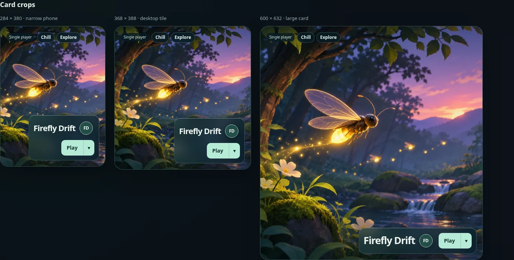
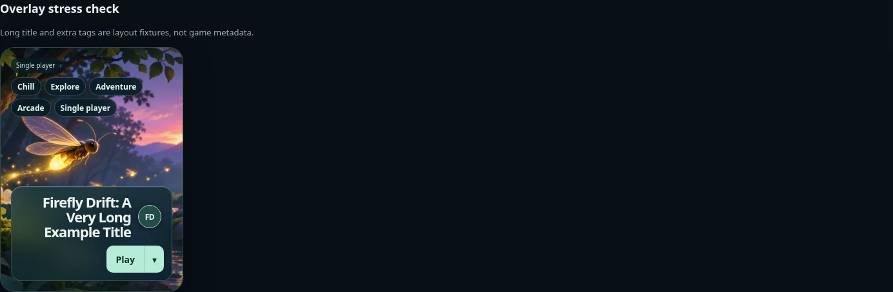

# Card hero guide: Firefly Drift trial

Audience: Infuser developers.

This is the first test of version 0.1 of [the draft guide](../../card-art-guide.md). It is a
review fixture, not the artwork of a published game.

## Input and result

The image generator received only the complete guide, the title **Firefly Drift**,
and a declaration that this was a guide-only concept test without gameplay facts
or references. No earlier Firefly image, private style prompt, or corrective art
direction was supplied. [prompt.txt](prompt.txt) records that exact input.

The generator interpreted the title as a golden firefly moving through a forest
stream at dusk. This is **AI-generated, unverified concept art**; it is not a
gameplay screenshot and does not establish what Firefly Drift actually contains.
The first render was used without a corrective generation pass. The guide is now
at 0.2 following the selected policy: faithful cover illustration, flexible subject
placement, and bounded overlays. The original 0.1 prompt is preserved unchanged;
the screenshots and preview use the updated overlay limits. This is not a new
generation claimed to test the revised guide's game-fidelity requirements.

The square generated source was 1254 × 1254. It was resized once to 1024 × 1024,
converted to opaque sRGB, stripped of metadata, and encoded as quality-84 WebP.
The submitted example, [firefly-drift.webp](firefly-drift.webp), is **105,164 bytes
(102.7 KiB)**, below the 250 KiB ceiling.

## Layout review

[index.html](index.html) loads the real Library stylesheet. Its only artwork
override is the guide's proposed centered-cover background; the card controls,
glass dock, typography, metadata chips, and wrapping use the existing styles.
The controls are inert and all titles/tags/initials are review fixtures.

Serve the repository root with a static file server and open
`/docs/design-explorations/card-art-guide/index.html`.

- Verified exact 284 × 380, 368 × 388, and 600 × 632 card crops in Chromium.
- The main firefly remains identifiable and unobscured in all three crops.
- The lower-right scene continues behind the dock; no blank panel or baked UI.
- A long title is capped at two lines, and five tags occupy one horizontally
  scrollable row. Metadata no longer expands over the art as its content grows.
- The 96px thumbnail retains the luminous insect silhouette; fine background
  leaves and flowers are secondary and need not remain individually legible.
- Preview page fits 320px and 390px viewports; docks remain within their cards.
- No browser script errors, external services, backend calls, or live game edits.

The first result passes the crop/composition checks. Whether its subject and
visual language match the real game still needs the game project's factual brief.
The test validates this guide's layout constraints, not an artwork-publishing API.

